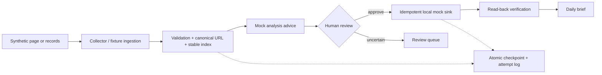

# Personal Agentic Workbench

A privacy-safe public reconstruction of a real personal workflow for large-scale job-information processing.

**Portfolio use only. Publicly viewable, not open-source.** See [NOTICE.md](NOTICE.md).

**Why:** raw job information is noisy and changes quickly. A recovered historical browser snippet reads Feishu multidimensional-table *record-detail cards*, including fields and links, and checks for 14 fields. Recovered verification notes report a segmented 7,155-record export; the underlying historical segments and merge report are not in this repository. Separately, a local source export has 7,155 indexed records. **None of this means 7,155 external recruiting websites were crawled.**

| Stage | What it demonstrates | Evidence boundary |
|---|---|---|
| 1. Historical workflow | Host-mediated browser extraction from rendered Feishu cards | Recovered code excerpt and historical notes; no private dataset published |
| 2. Private engineering reconstruction | Node.js/Playwright reliability reconstruction | Locally tested; implementation intentionally withheld as commercially valuable workflow IP |
| 3. Workbench | Deterministic processing → analysis advice → human approval → verified local sync → brief | Synthetic Python demo below; no live Feishu adapter |

**Engineering boundary:** browser/input → deterministic pipeline → analysis advice → human review → read-back-verified synchronization → brief. Atomic writes, checkpoints, idempotency, and rollback keep uncertain or failed work from silently becoming a completed decision. The public analysis provider is deterministic, not an LLM; no application is submitted automatically.



## 3-minute offline demo

From the repository root, with Python 3.10+:

```powershell
python scripts/demo.py
python scripts/demo_failure_recovery.py
python -m pytest -q
```

The first two commands need only Python's standard library and use fictional data in temporary folders. Tests require pytest (`python -m pip install -e ".[test]"`). No browser, real recruiting site, cookie, Feishu credential, or private résumé is needed for this quick start.

Local publication review: 9 tests passed and 1 optional browser test was skipped; both offline demos and Python compilation passed. The skipped test requires an installed Playwright browser and is not needed for the default demo.

The private Node/Playwright reconstruction is not part of this repository. The Python fixture adapter exposes an optional local-browser path, covered by a conditional test when Python Playwright and Chromium are installed.

## What the demo shows

The synthetic batch contains valid records, a canonical-URL duplicate, an ambiguous role held for review, and malformed input. Three explicitly approved items are written to a local adapter and read back. A separate demo simulates a post-write verification failure, compensates by rolling back, preserves the pending checkpoint, and resumes safely. The visible mock analysis is a replaceable interface example, not a claim of semantic LLM inference.

The original personal workflow included Feishu synchronization and a weekday 08:00 briefing. This repository publishes **only a mock sink** and an offline synthetic brief. The original automation evolved from broad pool expansion toward targeted processing and useful reminders; it is not reproduced verbatim or installed by this repo.

## Scope and limitations

- Recovered historical evidence confirms a **14-field count check and link extraction**, not the full historical field-name list. The Python fixture uses six illustrative fields; it is not the original private dataset.
- The HTML fixture parser is the default offline demonstration. A real Playwright path is present but optional.
- The mock analyzer does keyword-based suggestions; it does not call an LLM or evaluate the author's private résumé.
- The mock sink demonstrates semantics, not a live Feishu integration or production SLA.
- The private collection implementation is deliberately excluded because it contains commercially valuable workflow IP. This portfolio grants no open-source license.

See [provenance](docs/provenance.md), [architecture](docs/architecture.md), [reliability](docs/reliability.md), [automation](docs/automation.md), and [privacy](docs/privacy.md).
