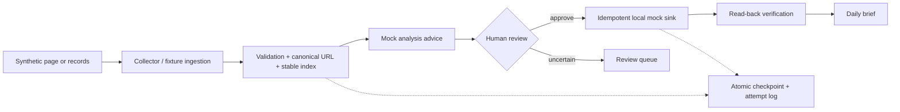

# Personal Agentic Workbench

A privacy-safe reconstruction of a personal recruiting-information workflow: collect evidence, process it deterministically, request human decisions, synchronize only approved items, and produce a concise brief.

**Why:** raw job information is noisy and changes quickly. The real personal workflow indexed a **7,155-record source export** and used recurring recruitment processing. That number is source records, **not 7,155 browser crawls**. The original Playwright crawler ran on another device; this repository is newly written portfolio-safe code, not its original source.

**Engineering boundary:** scripts validate, normalize, deduplicate, checkpoint, and sync; a replaceable analysis interface suggests fit; a person decides what to act on. The default “agent” is deterministic mock advice, not an LLM. No application is submitted automatically.



## 3-minute offline demo

From the repository root, with Python 3.10+:

```powershell
python scripts/demo.py
python scripts/demo_failure_recovery.py
python -m pytest -q
```

The first two commands need only Python's standard library and use fictional data in temporary folders. Tests require pytest (`python -m pip install -e ".[test]"`). The optional real Playwright route uses only the local synthetic HTML fixture:

```powershell
python -m pip install -e ".[browser]"
python -m playwright install chromium
python -c "from pathlib import Path; from personal_agentic_workbench.collector import extract_with_playwright; print(extract_with_playwright(Path('examples/synthetic_page.html')))"
```

Browser dependencies and installed Chromium are optional; the default demo runs offline. No real recruiting site, cookie, Feishu credential, or private résumé is used.

## What the demo shows

The synthetic batch contains valid records, a canonical-URL duplicate, an ambiguous role held for review, and malformed input. Three explicitly approved items are written to a local mock sink and read back. A separate demo simulates a post-write verification failure, compensates by rolling back, preserves the pending checkpoint, and resumes safely.

The original personal workflow included Feishu synchronization and a weekday 08:00 briefing. This repository publishes **only a mock sink** and an offline synthetic brief. The original automation evolved from broad pool expansion toward targeted processing and useful reminders; it is not reproduced verbatim or installed by this repo.

## Scope and limitations

- The exact original **14-field** Playwright extraction schema is not recoverable from the available transferred files. This reconstruction exposes a small verified/conceptually recoverable subset; do not equate it with the original schema.
- The HTML fixture parser is the default offline demonstration. A real Playwright path is present but optional.
- The mock analyzer does keyword-based suggestions; it does not call an LLM or evaluate the author's private résumé.
- The mock sink demonstrates semantics, not a live Feishu integration or production SLA.

See [provenance](docs/provenance.md), [architecture](docs/architecture.md), [reliability](docs/reliability.md), [automation](docs/automation.md), and [privacy](docs/privacy.md).
