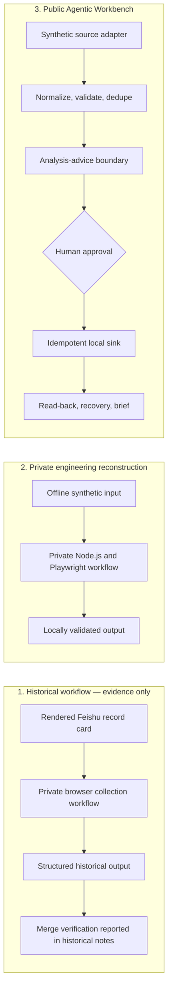

# Architecture and responsibility boundary

The stages are related by an operational problem, not by shared runtime or an uninterrupted deployment history.

| Actor | Owns | Never owns |
|---|---|---|
| Deterministic code | parsing, schema validation, URL normalization, exact deduplication, stable IDs, checkpointing, state transitions, mock sync, read-back | subjective hiring fit or silent approval |
| Analysis provider | fit summary, role-family suggestion, missing-requirement prompts, explanation | data integrity, final application decisions |
| Human reviewer | ambiguous cases, approval/rejection, high-risk external actions | machine-generated facts without checking |

The Python `MockAgent.analyze` is an intentionally deterministic stand-in, not an LLM. The Python `Pipeline` prevents unapproved records from entering its local sink. Ambiguous input enters `NEEDS_REVIEW`. The historical and reconstruction stages are shown only at interface level: their private implementation is intentionally withheld. The public workbench runs on synthetic data and has no live Feishu integration.
